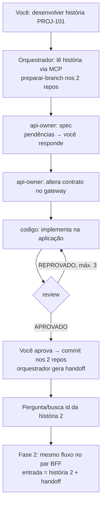

# Arquitetura do harness

## 1. O cenário

Dois pares de repos. Cada par anda junto numa mesma história:

| Par | Repos | História |
|---|---|---|
| Aplicação | aplicacao-java + gateway-padrao (contrato OpenAPI) | história 1 |
| BFF | web-bff + gateway-bff (contrato OpenAPI) | história 2, ligada à 1 |

- Criar, alterar ou excluir rota na aplicação **implica** alterar o contrato do gateway.
- O BFF **não tem regra de negócio**: replica as rotas da história 1 seguindo os padrões do BFF.

## 2. Onde cada coisa mora

```text
harness-kit (este repo)      → FONTE: skills, agentes, hooks, templates, docs
        │ sync.py (copia)
        ▼
aplicacao-java / web-bff     → INSTALADO: .claude/ + AGENTS.md + .harness/project.yaml
gateway-padrao / gateway-bff → INSTALADO: git hook + AGENTS.md + .harness/project.yaml
        │
sua máquina (fora do Git)    → LOCAL: ~/.harness/workspace.yaml, runs/active.json, handoffs
```

- **Nada roda de forma central.** O kit é uma biblioteca de arquivos versionada.
- **O orquestrador é o agente principal da sessão** seguindo a skill
  `desenvolver-historia`. Não existe outro programa orquestrando.
- A sessão é aberta na **aplicação** (o repo principal do par). Os gateways são
  passivos: ninguém abre sessão neles, o agente entra para alterar o contrato.

### Arquivos locais (por desenvolvedor, nunca commitados)

`~/.harness/workspace.yaml`: onde cada repo está clonado nesta máquina.
```yaml
repos:
  aplicacao-java: C:/dev/aplicacao-java
  gateway-padrao: C:/dev/gateway-padrao
  web-bff: C:/dev/web-bff
  gateway-bff: C:/dev/gateway-bff
```

`~/.harness/runs/active.json`: execução ativa (gravado pelo `preparar-branch`).
```json
{"historia": "PROJ-101", "repos": ["C:/dev/aplicacao-java", "C:/dev/gateway-padrao"]}
```

`~/.harness/runs/<id>/handoff.yaml`: ponte entre a história 1 e a 2.

### Conhecimento do repo (commitado)

`.harness/project.yaml` diz **quem é o par** (a relação é do time, por isso é
commitada). O caminho local fica no `workspace.yaml` (é de cada dev).

## 3. O fluxo (fixo)



Pontos de decisão humana (únicos): dados faltantes antes de delegar, confirmação
da spec, aprovação antes do commit e id da próxima história.

### Quem faz o quê

| Papel | Responsabilidade | Não faz |
|---|---|---|
| Você | inicia, responde pendências, aprova | — |
| Orquestrador | coordena, branch, commit, handoff | não edita código nem contrato |
| api-owner | spec e contrato OpenAPI | não toca em código nem em git |
| codigo | implementação + testes | não toca em git |
| review | confere spec × contrato × código × padrões | não edita nada |

Os subagents recebem um **briefing completo** (não veem a conversa) e sempre
leem o `AGENTS.md` do repo em que vão atuar.

## 4. Handoff entre as histórias

Gerado pelo orquestrador **depois do review OK**, a partir do **OpenAPI
commitado** (não da spec, não da memória do agente). Contém só a interface:
endpoints, schemas, erros e decisões. Nada de código ou regra de negócio.

Na fase 2, o api-owner mapeia cada endpoint do handoff para uma rota do BFF.
Padrão: repasse 1:1; só muda o que a história 2 pedir.

O handoff fica em arquivo para permitir retomar a fase 2 em outra sessão ou em
outra ferramenta.

## 5. Garantia de branch (`feature/<id>` a partir da develop)

Três camadas, cada uma num momento:

1. **Início**: `preparar-branch preparar` cria a branch ou faz checkout dela nos
   repos do par. Checa todos antes de alterar qualquer um. Falhou → nada é alterado.
2. **Durante**: hook PreToolUse em Edit/Write (`check_branch.py`) bloqueia edição
   fora da branch, olhando o repo **do arquivo**, não o da sessão. O orquestrador
   também roda `preparar-branch verificar` antes de cada etapa (cobre o Devin).
3. **Commit**: git hook pre-commit, rede final para qualquer ferramenta.

Sem `active.json`, os hooks não fazem nada (o trabalho manual não é afetado).
Ao terminar, o orquestrador roda `preparar-branch encerrar`.

## 6. Estrutura de uma skill

```text
desenvolver-historia/
├── SKILL.md              ← curto: papel, ordem das fases, regras
└── references/           ← carregado só quando a fase começa (progressive disclosure)
    ├── fase-aplicacao.md
    ├── fase-bff.md
    └── handoff-template.yaml
```

As instruções de cada fase ficam em arquivos de referência. No Claude Code elas
são executadas com subagents; se o Devin não tiver subagents, a mesma skill roda
as fases em sequência num agente só.

## 7. Sensores (verificação automática)

```text
agente diz "terminei" → hook Stop/SubagentStop → rodar_sensores.py
   ├─ lê .harness/sensores.json de cada repo da execução
   ├─ roda só os sensores cujos arquivos foram alterados
   ├─ grava ~/.harness/runs/<id>/sensores.json (o review lê daqui)
   └─ falhou? exit 2 + últimas 40 linhas → o agente continua (máx. 3x)
```

| Repo | Sensor | Comando |
|---|---|---|
| aplicação / BFF | build, testes, ArchUnit | `mvn -q verify` |
| gateways | contrato OpenAPI válido | `python -m openapi_spec_validator <contrato>` |

Guias (AGENTS.md, skills) orientam **antes**; sensores verificam **depois**.

## 8. Permissões

Instrução é guia; permissão é garantia. O `settings.json` do kit:

- **Nega** git de escrita (`commit`, `push`, `switch`, `checkout`, `reset`,
  `rebase`, `merge`, `stash`, `clean`), `mvn deploy`, `rm -rf`, `curl`/`wget` e
  leitura de credenciais (`.env`, `~/.m2/settings.xml`, `~/.aws`, `~/.ssh`,
  chaves).
- **Libera sem perguntar** git de leitura, os comandos dos sensores e o script
  `preparar_branch.py`.

Consequência: o **único caminho de escrita no git** é o `preparar_branch.py`
(`preparar` e `commit`), que sempre valida a branch antes.

## 9. Contrato entre agentes

```text
história ──► api-owner ──► spec.json ──► codigo ──► review
                            │  ▲
          hook ao salvar ───┘  └── corrige até passar
          gate --pronta (sem pendências) antes do código
```

- Formato: `.claude/contratos/spec.schema.json`.
- Validador: `.claude/contratos/validar_spec.py` (hook e linha de comando).
- Depois da spec, nenhum agente relê a história: a spec é a fonte da verdade.

## 10. MCP local (experimental)

```text
sessão abre ──► lê .mcp.json ──► inicia python .claude/mcp/harness_mcp.py (stdio)
                                     ├─ listar_endpoints   (codigo, api-owner)
                                     ├─ endpoint_modelo    (codigo)
                                     └─ comparar_contrato  (review)
sessão fecha ──► processo encerrado
```

Recuperação just-in-time: em vez de explorar o repo, o agente pede o que precisa
e recebe uma resposta curta. Sem o pacote `mcp`, `endpoints.py` roda como script.

## 11. Medição

```text
hooks (PostToolUse, SubagentStop, Stop, UserPromptSubmit)
  + marcos do orquestrador (fase, review) + sensores
        └──► ~/.harness/runs/<id>/log.jsonl ──► relatorio.py ──► resumo.json
                                         comparar_gabarito.py ──► acertou?
```

Roteiro de evals em `docs/evals.md`; resultados do case em `docs/case/resultados.md`.

## 12. Ciclo de aprendizado

```text
review (apontamentos com categoria) + sensores (qual falhou)
        └──► log de todas as execuções ──► aprendizado.py analisar
                ──► orquestrador sugere destino e texto ──► você aprova
                ──► regra aplicada fora da branch ──► aprendizado.py aplicar
```

Destino: o mais determinístico que resolve (sensor > AGENTS.md > skill > review).
Reincidência sobe um degrau.

## Mapa final: guias e sensores

| | Antes da ação (guias) | Depois da ação (sensores) |
|---|---|---|
| Contexto | AGENTS.md, skills, references, MCP | — |
| Processo | orquestrador, fases, handoff | review, gate da spec |
| Garantias | permissões, preparar-branch | hooks de branch, build/testes/ArchUnit/OpenAPI |
| Evolução | regras aprendidas | medição, evals, análise de recorrência |
